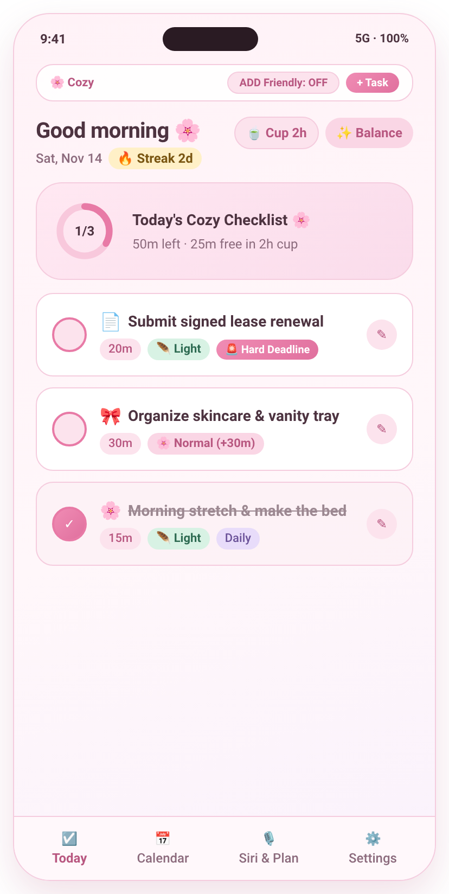
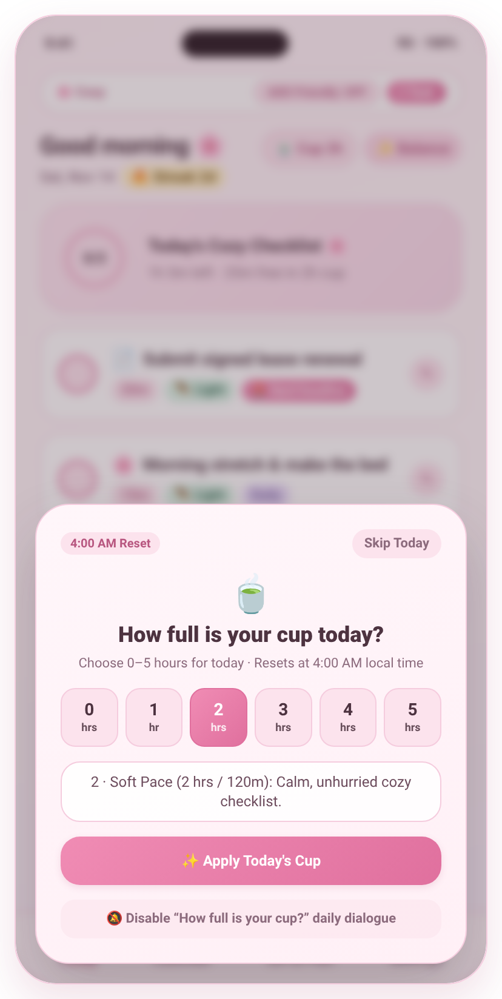
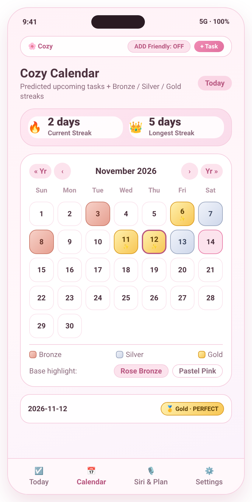
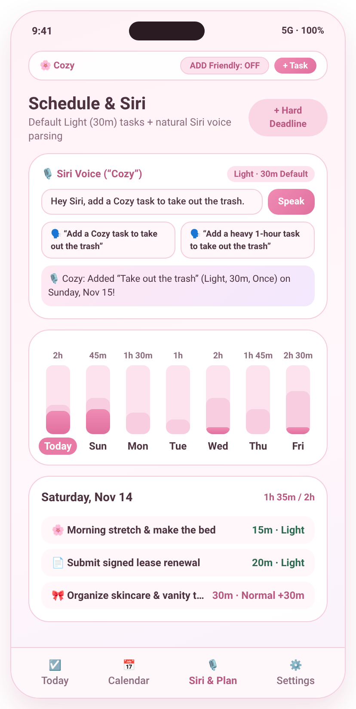
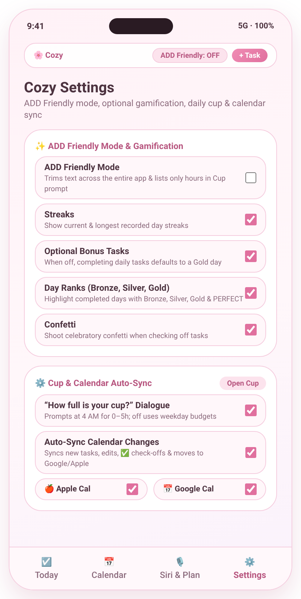

# Cozy 🌸

A calm, pastel-pink iPhone task tracking app (**Cozy**) built natively with **SwiftUI**, **SwiftData**, **AppIntents**, **EventKit**, **AuthenticationServices**, and **UserNotifications** (iOS 17+).

## Preview & Interactive Demo

> **Try it in your browser or grab the Beta build:**
> - 🌸 **[Launch Live Interactive HTML Demo →](https://maskarauder.github.io/CozyProductivity/)** *(check off tasks with pastel confetti, test the Morning Cup check-in, toggle **ADD Friendly Mode**, and try natural Siri phrases — standalone file at [`docs/index.html`](docs/index.html))*
> - 📦 **[Download Beta Signed IPA (`v1.0-beta.5`) →](https://github.com/maskarauder/CozyProductivity/releases/tag/v1.0-beta.5)** *(cloud-signed TestFlight Beta build & `dSYMs`)*

<div align="center">

| **Today's Checklist** | **Morning Cup (`0–5h`)** | **Cozy Calendar & Ranks** |
| :---: | :---: | :---: |
|  |  |  |
| Daily progress, task weights & Hard Deadlines<br/>[**Open interactively ↗**](https://maskarauder.github.io/CozyProductivity/?view=today) | *“How full is your cup today?”* (4 AM reset)<br/>[**Open interactively ↗**](https://maskarauder.github.io/CozyProductivity/?view=cup) | Bronze, Silver & Gold ✨ days + streaks<br/>[**Open interactively ↗**](https://maskarauder.github.io/CozyProductivity/?view=calendar) |

| **Siri & 7-Day Planner** | **Settings & ADD Friendly Mode** |
| :---: | :---: |
|  |  |
| Natural Siri voice capture & smart rebalance<br/>[**Open interactively ↗**](https://maskarauder.github.io/CozyProductivity/?view=schedule) | Low-text **ADD Friendly Mode**, 4 gamification toggles & calendar sync<br/>[**Open interactively ↗**](https://maskarauder.github.io/CozyProductivity/?view=settings) |

</div>

## Features

- **ADD Friendly Mode (Low-Text Focus Mode)**:
  - Optional toggle in **Settings** that reduces text across the entire app—cutting out subtitles, emojis, categories, and cozy prose.
  - In **ADD Friendly Mode**, the *“How full is your cup today?”* dialogue lists **only the hours** (`0 hours` … `5 hours`) with zero extra details.
- **Optional Gamification (4 Independent Settings)**:
  - Every gamified element can be individually disabled in **Settings**:
    - **Streaks**: Show or hide current and longest recorded streak counters, pills, and Siri streak announcements.
    - **Optional Bonus Tasks**: Show or hide the 2 optional bonus slots from the next 7 days. **When disabled, completing your daily tasks defaults to a Gold day.**
    - **Day Ranks (`Bronze`, `Silver`, `Gold`)**: Enable or disable Bronze, Silver, and Gold day ranks and `PERFECT` banners across Today, Calendar, and Summaries.
    - **Confetti**: Enable or disable celebratory pastel confetti bursts when checking off tasks.
- **Default Light 30-Minute Tasks & Editable Task Weights (`Light`, `Normal`, `Heavy`)**:
  - New tasks default to **`Light` (`+0m`)**, **`30 minutes`**, and **`Once`**, keeping quick capture effortless.
  - Edit any task anytime (via **Edit Task** or the card's `•••` menu) to adjust its duration, recurrence, Hard Deadline, or weight (**`Light` (`+0m`)**, **`Normal` (`+30m`)**, or **`Heavy` (`+1h`)**), automatically rebalancing the day's schedule.
- **Optional Morning Cup Check-In (*“How full is your cup today?”*) & 4:00 AM Reset**:
  - Prompts at the start of each day—resetting at **4:00 AM local time**—for an answer from **`0` to `5` hours**, setting that day's available capacity.
  - Future calendar days continue showing upcoming tasks as predicted, while answering **`0`** gently moves non-deadline tasks back each day.
  - Disableable anytime from the prompt or **Settings** to use your weekday free-time budgets automatically.
- **Hard Deadlines**:
  - Assign an optional **Hard Deadline** to force a task onto/before its deadline even when your daily cup does not have enough hours to fulfill it.
- **Native Siri & Apple Shortcuts Voice Commands (`AppIntents`)**:
  - Zero external API keys required—uses the **`Cozy`** app name natively with Siri, Spotlight, and Shortcuts:
    - *“Hey Siri, add a Cozy task to take out the trash”* (creates a default **Light**, **30-minute**, **Once** task and places it on a freer day).
    - *“Hey Siri, add a heavy 1-hour Cozy task to take out the trash”* / *“Add a heavy 1-hour task to take out the trash”* (`SiriTaskPhraseParser` extracts weight, duration, and frequency directly from natural speech).
    - *“Hey Siri, set my cup in Cozy”*
    - *“Hey Siri, complete a task in Cozy”*
    - *“Hey Siri, what's on my Cozy today?”*
    - *“Hey Siri, check my streak in Cozy”*
    - *“Hey Siri, sync calendars in Cozy”*
- **Today's Checklist Cards, Month/Year Calendar & Summaries**:
  - Tactile pastel checklist cards for Today, full Month/Year Calendar navigation with day highlights, and End-of-Day + optional Weekly & Monthly summary notifications.
- **Auto-Sync All Changes to Google and/or Apple Calendars**:
  - Automatically syncs task additions, edits, check-offs (`✅`), moves, deletions, and schedule rebalances to **Google Calendar** (OAuth 2.0 PKCE or iPhone Account Bridge) and/or **Apple Calendar (`EventKit`)**, while union-merging external busy events without self-feedback loops.

## Project Structure

```text
CozyProductivity/
├── App/          # @main App entry point, RootTabView 4 AM Cup prompt + calendar + notification orchestration
├── Theme/        # CozyTheme pastel pink palette, Bronze/Silver/Gold medal gradients & modifiers
├── Models/       # SwiftData @Model definitions (TaskTemplate, TaskOccurrence, CozyPreferences, DayCapacityOverride, TaskWeight)
├── Services/     # SmartScheduler, StreakAndBonusService, GoogleCalendarService, CalendarFreeTimeService, KeychainHelper, CozyModelContainer, SummaryBuilder, NotificationManager, DateHelpers
├── Intents/      # CozyShortcuts (Siri AppIntents + SiriTaskPhraseParser for natural weight/duration voice capture)
├── Views/        # TodayChecklistView, DailyCupPromptSheet, MonthCalendarView, ConfettiCelebrationOverlay, ScheduleOverviewView, TaskEditorSheet, ReflectionsView, CozySettingsView
└── Assets.xcassets/ # Pastel rose AccentColor & 1024x1024 AppIcon
CozyProductivityTests/
└── SmartSchedulerTests.swift # Unit tests for Light 30m defaults, Siri phrase parsing, optional gamification & Gold default, 4 AM cup reset, weights, hard deadlines & calendar sync
```

## Getting Started in Xcode

1. Open `CozyProductivity.xcodeproj` in **Xcode 15 / 16+**.
2. Select the **CozyProductivity** scheme (display name on iPhone: **Cozy**) and choose an iPhone simulator (iOS 17.0+) or your physical iPhone (set your Development Team under *Signing & Capabilities* if deploying to hardware).
3. *(Optional for Direct Google OAuth PKCE)*: Either use the built-in **iPhone Google Account Bridge** (zero configuration if Gmail is signed into *iPhone Settings → Calendar → Accounts*) or create an **iOS OAuth 2.0 Client ID** in Google Cloud Console with the Google Calendar API enabled and paste the Client ID into *Settings → Google Calendar* (adding the reversed Client ID URL scheme `com.googleusercontent.apps.<YOUR_PREFIX>` under *Target → Info → URL Types*).
4. Press **⌘R** to build and run, or **⌘U** to run the unit tests in `CozyProductivityTests`.
